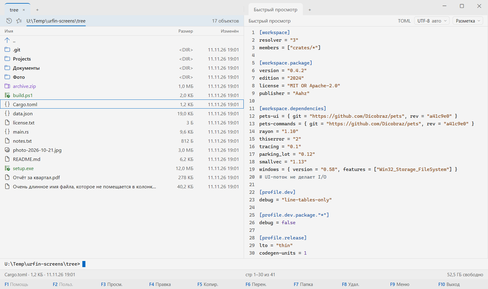
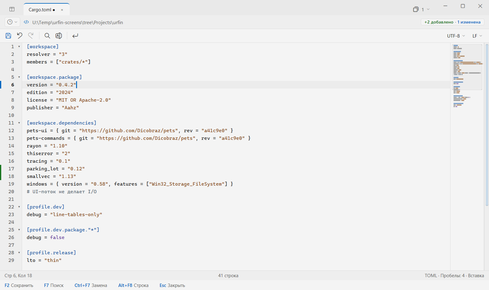
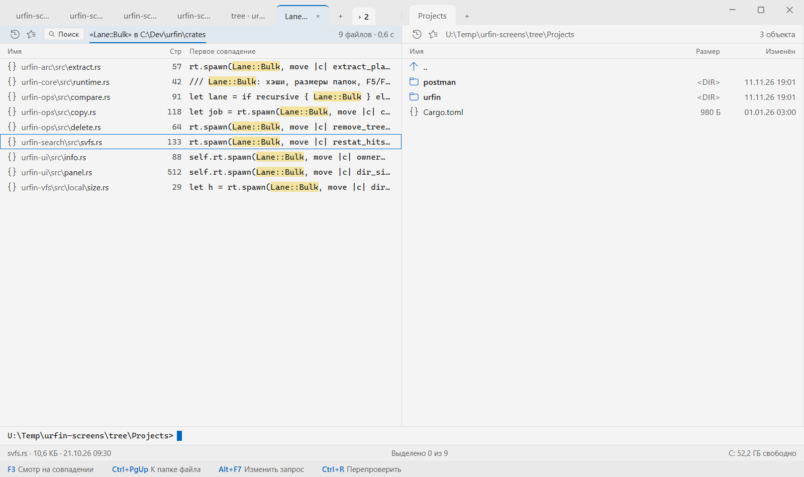
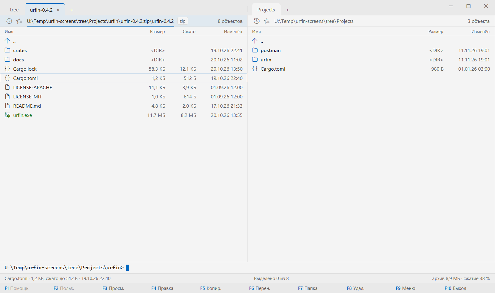
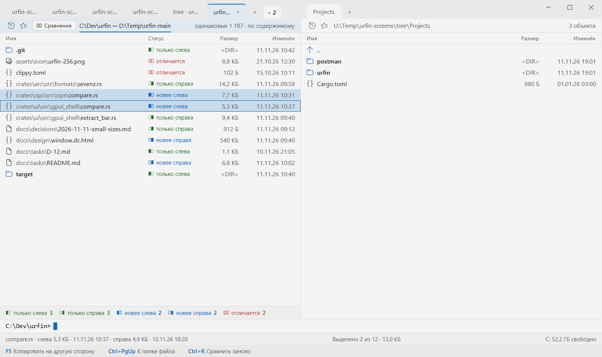
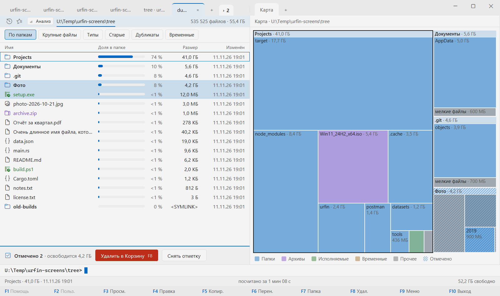

  

<h1 align="center">Urfin</h1>

  <b>Двухпанельный файловый менеджер для Windows — привычный, как Far и DN, быстрый и современный.</b>

  <a href="https://github.com/Dicobraz421/Urfin/releases"><b>Скачать</b></a> ·
  <a href="docs/keys.md"><b>Клавиши</b></a>

> **Бета-версия.** Основное работает, идёт проверка — возможны шероховатости.

## Что умеет

### Панели как в Far и DN, только быстрее

Две панели с вкладками, клавиши Far или DN на выбор — и сочетания с буквами работают на любой раскладке, даже
когда включён русский. **100 000 файлов в папке листаются без задержек**, а панель сама обновляется, когда файлы
меняются на диске.

- **Виды** — краткий, средний, полный и широкий; свои колонки: тип, расширение, время создания и доступа, атрибуты.
- **Дерево, «Сведения» и быстрый просмотр** — рядом с панелью, без отдельных окон.
- **Быстрый переход** — щелчок по части пути, закладки, история, быстрый поиск по Alt+буква.
- **Сортировка, фильтр, скрытые файлы, размер папок** — по одной клавише.
- **Свои клавиши** — в настройках: список с поиском, правка сочетаний, подсказки о конфликтах.

### Копирование, которое не мешает работать

Копирование и перенос встают в очередь и идут в фоне — можно работать дальше. Если файл уже есть, вопрос появится
строкой, а не окном поверх всего. Прерванное копирование можно продолжить и после перезапуска, крупные файлы на
сеть и флешку докачиваются, а на ReFS и Dev Drive копия делается почти мгновенно.

Ещё: удаление в Корзину и насовсем, создание папок сразу деревом, групповое переименование, ссылки, атрибуты и время
файлов, сравнение и синхронизация папок.

### Терминал под рукой

Ctrl+O убирает панели и показывает терминал — PowerShell, cmd, Git Bash или WSL. Папка панели и папка терминала
всегда одна и та же, в обе стороны. Командная строка подсказывает пути, команды и прошлые вызовы, имя файла из
панели вставляется одной клавишей. По выводу можно искать, а Far запускается прямо внутри.

### Просмотр и правка файлов любого размера

F3 — просмотр: текст, hex, кодировки, поиск, закладки, слежение за растущим логом. F4 — редактор: поиск и замена,
блочное выделение, свёртка, мини-карта. Лог на 10 ГБ открывается сразу и листается без задержек, а сохраняется
потоком — памяти хватит. Markdown показывается как документ, с предпросмотром рядом.

**Подсветка** не замедляет даже огромные файлы: JSON, TOML, INI, XML, YAML, Markdown, Rust, C, C++, C#, Java, Go,
JavaScript, TypeScript, Python, CSS, Lua и другие.

### Поиск, который не заставляет ждать

Alt+F7 — поиск по именам и по содержимому со скоростью `rg`. Результаты появляются по мере обхода, совпадение видно
сразу, F3 и F4 открывают найденное. Список результатов — обычная панель: копируйте, удаляйте, заходите в папки.

### Архивы как папки

ZIP, 7z, RAR, TAR и сжатые `.tar.gz`, `.bz2`, `.xz`, `.zst` открываются по Enter, как обычная папка, — даже архив
внутри архива. Зашифрованный архив спросит пароль строкой. Из архива можно копировать и сравнивать, распаковывать
целиком или выборочно, проверять, не повреждён ли он. Подозрительно сильно сжатое — похожее на «zip-бомбу» — Urfin
без спроса распаковывать не станет.

### Сравнение папок

Сравнение с подпапками или по содержимому — в меню «Команды». Результат открывается вкладкой `cmp:`: видно, каких
файлов нет на одной из сторон и что изменилось, а F5 и F6 переносят отличия на другую сторону.

### Куда делось место на диске

«Анализ места» в меню «Утилиты» показывает, что занимает диск: список по размеру и карту, крупные, старые и
временные файлы, дубликаты. Изменения на диске видны вживую, повторный анализ быстрый. Временные файлы можно
отметить и очистить тут же.

### Программы: winget, Scoop, Chocolatey

Вкладка «Пакеты» собирает программы из всех найденных менеджеров пакетов: что установлено, что обновить, поиск
сразу во всех, установка, обновление и удаление. Проверку обновлений можно поставить по расписанию.

### Серверы по SSH и SFTP

Подключения из `~/.ssh/config` и PuTTY, ключи, пароль, двухфакторный вход, агент и Pageant, промежуточный сервер.
Папка на сервере открывается в панели: копирование с докачкой, правка удалённых файлов, сравнение и синхронизация.
Рядом — терминал того же сервера, одна команда сразу на нескольких серверах, запись сеанса.

### Для организаций

Администратор может задать настройки политикой — файлом или через групповые политики Windows. Закреплённые
настройки отмечены замком.

### Оформление

Светлая и тёмная темы, тема по системе и свои, цвет акцента Windows, цветные значки. Интерфейс на русском и
английском. Urfin работает без сети и ничего никуда не отправляет.

## Установка

Windows 10 или 11 (64 бита). Файл — на странице [выпусков](https://github.com/Dicobraz421/Urfin/releases):

1. Скачайте zip-архив и распакуйте его в любую папку.
2. Запустите `urfin.exe`.

Рядом с программой лежат её части — встроенный терминал (ConPTY) и пакеты подсветки; держите их вместе. Файл
`urfin.portable` рядом с `urfin.exe` включает переносной режим: настройки хранятся в папке программы, её можно
носить на флешке.

Программа пока не подписана. Если Windows покажет «Система Windows защитила ваш компьютер», нажмите «Подробнее» →
«Выполнить в любом случае».

## Ещё

- [Клавиши](docs/keys.md) — все сочетания наборов Far и DN.
- [Команды](docs/COMMANDS.md) — полный список команд.
- [Для разработчиков](docs/README.md) — состояние, устройство, сборка, замеры.
- Лицензия — на выбор [MIT](LICENSE-MIT) или [Apache 2.0](LICENSE-APACHE).
